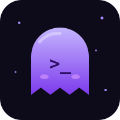

<div align="center">


<p align="center">
  
</p>

<p align="center">
  <a href="https://github.com/Soulspaces">
    
  </a>
</p>

<p align="center">
  
  
  
</p>

<p align="center">
  <a href="https://soulspace.bond"><b>soulspace.bond</b></a>
</p>

</div>

---

```console
$ whoami
soulspace: private CTF team, based in Malaysia

$ cat focus.txt
web  crypto  forensics  osint  reverse  misc  pwn(learning)

$ cat status.txt
tools:    private, in active development
mode:     learning something new every event
```

## About

Soulspace is a small, private CTF team. We come from unrelated majors (physics, law, business, medicine), started out gaming together, and ended up in cybersecurity.

We play CTFs, write our own tooling, and try to learn something from every event.

> Not the most serious team, but we show up. And we learn every time.

## Achievements

| Event | Placement | Percentile | Date |
|:--|:--|:--|:--|
| **CSCTF 2026: Total Warfare** (Seniors) | **68** of 609 teams | Top 11% | Nov 2026 |
| **TryHackMe: Downtime** | **377** of 1800+ teams | Top 21% | 2026 |

## Toolkit

> [!NOTE]
> All tools are in active development and currently private. Public releases will come when they are ready.

| Tool | Purpose | Status |
|:--|:--|:--|
| **Void-Recon** | Passive recon and local forensics toolkit for CTF | Private, in development |
| `[REDACTED]` | ???? | Private, prototype |
| `[REDACTED]` | ???? | Private, planned |

## Focus areas

| Category | What we do |
|:--|:--|
| **web** | Injection, auth flaws, logic bugs |
| **crypto** | Broken schemes and implementation mistakes |
| **forensics** | Disk, memory and packet captures |
| **osint** | Open-source investigation |
| **reverse** | Binaries and protocols |
| **misc** | Everything that does not fit elsewhere |
| **pwn** | Still learning |

## Stack

<p align="center">
  
  
  
  
  
  
  
</p>

## Ethics

> [!IMPORTANT]
> We only test on CTF platforms, our own systems, and targets that have given explicit permission. Learn, don't harm.

## Contact

For collaboration or early access to our tools, reach out through the website or GitHub.

<p align="center">
  <a href="https://github.com/Soulspaces"></a>
  <a href="https://soulspace.bond"></a>
  <a href="#contact"></a>
</p>

<div align="center">


<sub><code>flag{soulspace_was_here}</code></sub>

</div>
